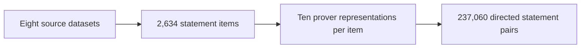

# ITPEval: Benchmarking Formal Translation Across Interactive Theorem Provers

ITPEval evaluates formal statement translation across **ten theorem provers**:
Lean 4, Rocq (Coq), Isabelle/HOL, HOL Light, ACL2, Agda, HOL4, Metamath,
Mizar, and PVS.

The extended statement corpus contains **2,634 aligned items / 26,340 prover
records from eight datasets**. Each included item has representations in all
ten systems, yielding **90 directed pairs per item / 237,060 possible pairs**.
An item can be a topic file with several lemmas, a catalogue entry, an axiom,
a competition problem, or a program-verification condition. These are inventory
counts, not counts of independent proved theorems or certified equivalences.



## Dataset scope

| Dataset | Aligned statement items | Statement records |
|---|---:|---:|
| Babel-formal | 15 | 150 |
| Hundred Theorems | 100 | 1,000 |
| miniF2F | 455 | 4,550 |
| PutnamBench | 657 | 6,570 |
| nTP4VC | 597 | 5,970 |
| Logipedia | 394 | 3,940 |
| Thousand Theorems | 227 | 2,270 |
| VERINA | 189 | 1,890 |
| **Total** | **2,634** | **26,340** |

All ten provers use the same statement corpus and translation interface.
Proof data is a separate modality: the available export contains **74 items /
296 records / 888 pairs** in Lean 4, Rocq, Isabelle/HOL, and HOL Light.
There are 73 identities shared by the statement and proof components; Babel's
`supinf` is outside the ten-way statement intersection. ACL2r is not counted as
ordinary ACL2 and is not one of this release's adapters.

See [the dataset description](docs/new_data_description.md) for exact membership,
source provenance, identity aliases, exclusions, and validation boundaries.
Native acceptance of a statement does not establish equivalence or proof completion.

## Quick start

Use a repository checkout and Python 3.10 or newer:

```bash
pip install -e .
cp eval/.env.example eval/.env
# Set the API keys for the providers you use.
```

On Amazon Linux 2023, install the bootstrap dependencies and desired provers:

```bash
./itpeval/bin/bootstrap-system.sh
./itpeval/bin/itpeval install lean4 rocq isabelle hol-light acl2 agda hol4 metamath mizar pvs
./itpeval/bin/itpeval check --task hello lean4 rocq isabelle hol-light acl2 agda hol4 metamath mizar pvs
```

On macOS use `bootstrap-macos.sh`. The supported automatic installation set is
`lean4 rocq isabelle hol-light agda hol4 metamath pvs`; ACL2 requires an existing
installation, and the Mizar adapter requires Linux/x86. See
[the harness guide](itpeval/README.md) for platform details and version overrides.

Preview one extended statement translation without API calls or prover execution:

```bash
python3 -m eval.pipeline.translation.run \
  --sources babel-formal --ids 1 \
  --src lean4 --tgt pvs --model gpt-5.5 --dry-run
```

Remove `--dry-run` to generate and verify. Statement translation is the default;
`--src` and `--tgt` accept any of the ten prover IDs through the same interface.
Use `--mode proofs` for the available proof records:

```bash
python3 -m eval.pipeline.translation.run \
  --mode proofs --sources babel-formal --ids 1 \
  --src lean4 --tgt rocq --model gpt-5.5 --dry-run
```

For batch jobs, inspect the selection before submission:

```bash
python3 -m eval.pipeline.translation.batch_run submit \
  --sources babel-formal --ids 1 --src lean4 --tgt agda \
  --models gpt-5.5 --dry-run
```

See [eval/README.md](eval/README.md) for collection, checkpointing, and filters.
The existing BEq implementation supports **Lean 4 targets only** and is not yet
connected to the statement shards. Native statement checking supports all ten
provers; semantic equivalence requires a separate checker.

## Data access and validation

```python
from eval.pipeline.translation.data import load_statement_records

statements = load_statement_records()  # 26,340 records, checksum-verified shards
lean_statements = [r for r in statements if r["prover"] == "lean4"]
```

```bash
python3 data/build_eval_jsons.py --check
python3 docs/audit_extended_dataset.py
python3 -m unittest discover -s eval/pipeline/tests
python3 -m unittest discover -s itpeval/tests
```

The build check compares exports with source bytes without writing. The inventory
audit counts representations; neither command runs theorem provers. Unit tests
use local fixtures and mocked verifier executables.

## Repository layout

- `data/`: benchmark sources, metadata, and deterministic export utilities.
- `eval/data/extended/`: one JSON shard per dataset and a checksum manifest.
- `eval/data/proofs.json`: available proof records.
- `eval/data/stmts.json`: archived reference export used by the existing BEq runner.
- `eval/subsets/`: statement membership and stable identity manifests.
- `eval/pipeline/`: generation, native verification, cycle, and existing BEq code.
- `itpeval/`: ten native adapters, shared runner, and smoke tasks.
- `docs/`: detailed dataset scope and a standalone inventory audit.

The root [LICENSE](LICENSE) covers original repository material. Third-party
source notices are indexed in [data/third_party_licenses/README.md](data/third_party_licenses/README.md).
