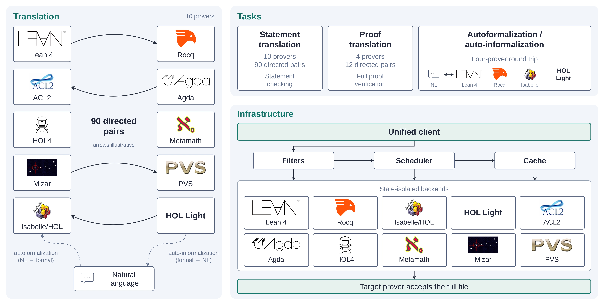

# Translation benchmark



A translation task asks a model to write a statement or proof from one prover in another prover’s language. ITPEval runs the destination prover on the result. [Run a translation task](../guides/formalization-and-translation.md)

The extended corpus has **2,634 items from eight datasets** and **26,340 statement records**, one per item in each of ten provers. At $10 \times 9 = 90$ directions per item, it defines **237,060 possible translation inputs**. [Dataset membership](../new_data_description.md)

## Published evaluation

The paper evaluated five models across 12 ordered pairs of Lean 4, Rocq, Isabelle/HOL and HOL Light. The best first-candidate acceptance rates (pass@1) were **29.1% for statements** and **10.5% for proofs**. The authors also ran English round trips on 100 miniF2F items and used Lean’s BEq to check both directions of implication against the reference. [ITPEval paper, §§2–4](https://arxiv.org/html/2607.19407v1)

## How ITPEval compares

The paper’s priority claim concerns benchmarking automated proof translation across **Lean 4, Rocq, Isabelle/HOL and HOL Light together**. The ten-prover extension supplies statement inputs and Python interfaces for native checks, extraction and proof-repair episodes. [Backend capabilities](../reference/capabilities.md)

| Earlier work | What overlaps with ITPEval |
|---|---|
| ProofGym | A common Python interface for Lean, Coq and Isabelle, with whole-proof checking and interactive steps. The authors also report generating 50,000 informal–formal statement pairs per language. [ProofGym paper](https://openreview.net/pdf?id=RrSQxcg6Nu) |
| ITP-Interface and ProofWala | A shared agent interface and multilingual proof data. ProofWala reports training and proof-search experiments in Lean and Coq. [Framework](https://github.com/trishullab/itp-interface) · [Paper](https://arxiv.org/abs/2502.04671) |
| Open Archive of Formalizations | Library export at scale. The authors describe exporting libraries from Coq, HOL Light, IMPS, Isabelle, Mizar and PVS to OMDoc/MMT. [Library export study](https://doi.org/10.1007/s10817-021-09604-0) |
| Dedukti and Logipedia | Transport of proofs through a common logical representation, including an arithmetic library exported to several assistants. [Project](https://logipedia.inria.fr/about/about.php) |
| Babel-formal and miniF2F | Babel-formal translates proofs between Lean and Rocq. MiniF2F introduced shared Olympiad-style problems for comparing provers. Both contribute material to ITPEval. [Babel-formal](https://github.com/LLM4Rocq/babel-formal) · [MiniF2F paper](https://arxiv.org/abs/2109.00110) |

The paper timed batches of translated statements. The runtime suite also times individual checks, project-lock loading and result reuse. [Runtime measurements](../runtime/measurements.md)

## Dataset scope

| Dataset | Aligned statement items | Statement records |
|---|---:|---:|
| Babel-formal | 15 | 150 |
| Hundred Theorems | 100 | 1,000 |
| miniF2F | 455 | 4,550 |
| PutnamBench | 657 | 6,570 |
| nTP4VC | 597 | 5,970 |
| Logipedia | 394 | 3,940 |
| Thousand Theorems | 227 | 2,270 |
| VERINA | 189 | 1,890 |
| **Total** | **2,634** | **26,340** |

The proof export contains **74 items, 296 records and 888 possible directed pairs** in Lean 4, Rocq, Isabelle/HOL and HOL Light. Seventy-three items also appear in the ten-prover statement corpus. Babel’s `supinf` appears only in the proof export. The ten-prover selection counts ordinary ACL2. [Proof membership and source provenance](../new_data_description/coverage-and-audit.md#10-proof-data-availability)

## Quick start

Use Python 3.10 or newer. Set your provider’s API key in `eval/.env` to generate candidates. The prompt preview works with the template.

```bash
# Install the benchmark dependencies and initialize the provider configuration.
python -m pip install -e '.[evaluation]'
test -e eval/.env || cp eval/.env.example eval/.env
# Set the API keys for the providers you use.
```

On the machine that runs verification, install the target prover. The following commands set up the Lean 4 and PVS tools used in this walkthrough. [Platform installation](../runtime/toolchains.md)

```bash
# Install the two provers used below and check the bundled examples.
itpeval install lean4 pvs
itpeval check --task hello lean4 pvs
```

Preview one extended statement translation without API calls or prover execution:

```bash
# Preview one statement translation without calling a model.
python3 -m eval.pipeline.translation.run \
  --sources babel-formal --ids 1 \
  --src lean4 --tgt pvs --model gpt-5.5 --dry-run
```

Remove `--dry-run` to generate and verify. Statement translation is the default.
`--src` and `--tgt` accept any of the ten prover IDs. For theorem proofs from the
four-prover export, use `--mode proofs`.

```bash
# Switch to a proof task and preview the Lean-to-Rocq prompt.
python3 -m eval.pipeline.translation.run \
  --mode proofs --sources babel-formal --ids 1 \
  --src lean4 --tgt rocq --model gpt-5.5 --dry-run
```

Use the batch command to preview the selected inputs before submitting a larger run.

```bash
# Preview a batch request from Lean to Agda.
python3 -m eval.pipeline.translation.batch_run submit \
  --sources babel-formal --ids 1 --src lean4 --tgt agda \
  --models gpt-5.5 --dry-run
```

See [eval/README.md](../../eval/README.md) for collection, checkpointing, and filters.
For verified **Lean 4** statement translations, the BEq runner can look up a reference in either the published corpus or the extended statement shards and try to prove both implications. [Semantic equivalence in Lean](../guides/formalization-and-translation.md#semantic-equivalence-in-lean)

## Data access and validation

From a checkout, load the released statements in a regular Python session on Windows, macOS or Linux. The dataset reader uses the standard library and checks each shard’s checksum.

```python
# Read the miniF2F records, then select the Lean representation of each problem.
from eval.pipeline.translation.data import load_statement_records

statements = load_statement_records(sources=["minif2f"])
lean_statements = [r for r in statements if r["prover"] == "lean4"]
```

```bash
# Validate the generated benchmark inventory against its checked-in inputs.
python3 data/build_eval_jsons.py --check
python3 docs/audit_extended_dataset.py
python3 -m unittest discover -s eval/pipeline/tests
python3 -m unittest discover -s itpeval/tests
```

The build check compares exports with source bytes. The audit counts item IDs and prover representations. Unit tests use local fixtures and mocked verifiers.

## Repository layout

- `data/`: benchmark sources, metadata, and deterministic export utilities.
- `eval/data/extended/`: one JSON shard per dataset and a checksum manifest.
- `eval/data/proofs.json`: available proof records.
- `eval/data/stmts.json`: archived reference export used by the existing BEq runner.
- `eval/subsets/`: statement membership and stable identity manifests.
- `eval/pipeline/`: generation, native verification, cycle, and existing BEq code.
- `itpeval/`: ten native adapters, shared runner, and smoke tasks.
- `docs/`: detailed dataset scope and a standalone inventory audit.

The root [LICENSE](../../LICENSE) covers original repository material. Third-party
source notices are indexed in [data/third_party_licenses/README.md](../../data/third_party_licenses/README.md).
